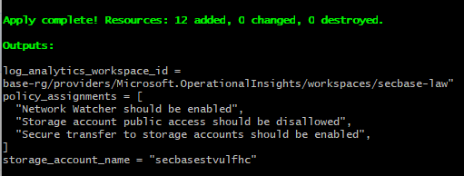
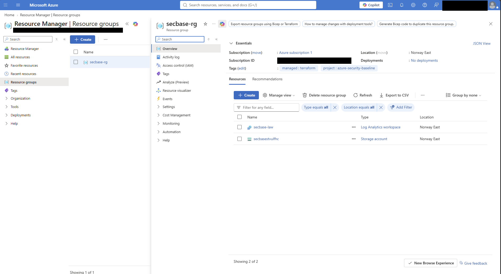
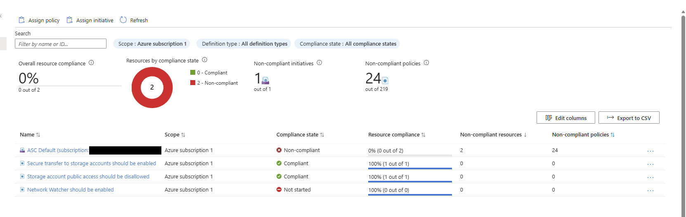
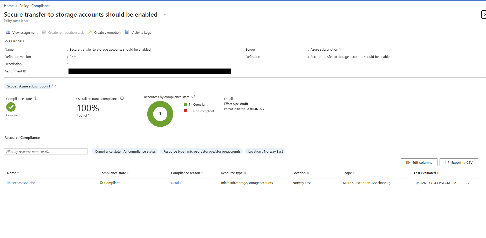
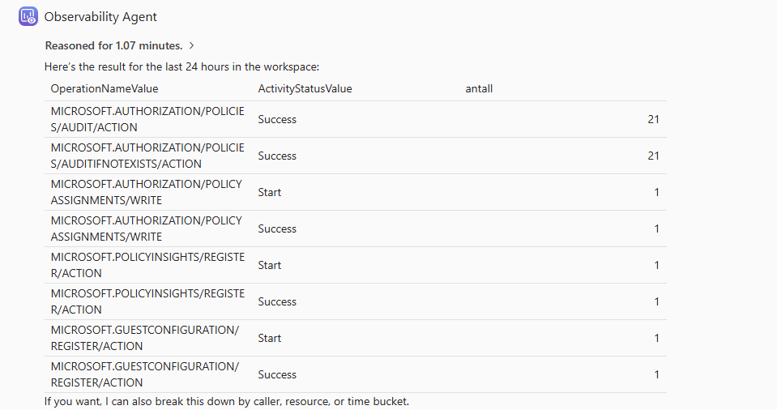
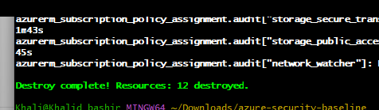

# Azure Security Baseline

A Terraform baseline for securing a fresh Azure subscription: central logging,
audit-mode policy, least-privilege access, optional Defender for Cloud plans and
a cost guardrail. It is the Azure counterpart to my
[AWS Cloud Security Baseline](https://github.com/adankhalid0/aws-cloud-security-baseline).

## What it sets up

| Area | Resources | Why |
|------|-----------|-----|
| Logging | Log Analytics workspace, Activity Log diagnostic setting (Administrative, Security, Policy, Alert, Recommendation) | Every control-plane action is searchable in one place (KQL) |
| Governance | `azurerm_subscription_policy_assignment` for built-in policies, in **Audit** mode | Reports non-compliance without breaking existing resources |
| Access | Optional `Security Reader` role assignments at subscription scope | Reviewers get read-only access, nothing more |
| Threat protection | Defender for Cloud plans (Storage, Key Vault, Resource Manager), off by default | Paid plans are opt-in via `enable_defender_plans` |
| Data | Example hardened storage account: HTTPS only, TLS 1.2, no public blobs, versioning and soft delete | Secure-by-default pattern for exported logs/evidence |
| Cost | Monthly budget with 80% alert and a Log Analytics daily cap | Keeps a free/trial subscription from surprising you |

## Usage

Full walkthrough for Git Bash and Kali Linux: [docs/STEP-BY-STEP.md](docs/STEP-BY-STEP.md). Short version:

```bash
az login
# register providers once (see step 4 in the walkthrough)
cp terraform.tfvars.example terraform.tfvars   # set subscription_id and e-mail
terraform init
terraform fmt -recursive
terraform plan
terraform apply
```

Then open **Log Analytics > Logs** and run, for example:

```kusto
AzureActivity
| where TimeGenerated > ago(1d)
| summarize count() by OperationNameValue, ActivityStatusValue
| order by count_ desc
```

Remove everything with `terraform destroy`.

## Results from a real deployment

I deployed this to a free Azure subscription (Norway East) and verified it in the
portal. `terraform apply` created 12 resources:



The resource group contains the Log Analytics workspace and the hardened storage
account, tagged `managed: terraform`:



The three audit policies were assigned at subscription scope. Two evaluated as
**Compliant** against the storage account; Network Watcher shows "Not started"
because it had not been evaluated yet when I took the screenshot:



The effect is `Audit`, as intended, with no parent initiative:



Activity Log entries reach Log Analytics, including the policy evaluations and
the assignment writes made by Terraform itself:



Everything was removed again with `terraform destroy`, so the test run left
nothing behind and cost nothing:



> **Note on "ASC Default".** The compliance view also lists Microsoft's own
> default security initiative, which reports non-compliant resources. That
> initiative is assigned by Defender for Cloud on every subscription and is not
> part of this baseline. The baseline's own policies are the three rows below it.

## Design decisions

- **Audit, not Deny.** Policies report only. Deny effects are a next step once the
  findings are understood, since they can block legitimate deployments.
- **Free tier by default.** Defender plans are billed, so they are opt-in.
- **Storage network rules not locked down.** Denying public network access on the
  storage account would stop Terraform itself from reading some account
  properties from a laptop or CI runner. In a production setup this is solved with
  a private endpoint and a self-hosted runner.
- **No remote state.** State is local and git-ignored. A real team setup would use
  an Azure Storage backend with state locking.

## What I learned running it

- **azurerm v4 requires `subscription_id`** in the provider block (or the
  `ARM_SUBSCRIPTION_ID` environment variable).
- **Automatic provider registration is slow.** On the first `terraform plan`, the
  provider tried to register every resource provider, including unrelated ones,
  and I interrupted it. I registered the five providers I need with the Azure CLI
  and set `resource_provider_registrations = "none"`. Do not press Ctrl+C during
  registration; wait for the providers to finish or register them first.
- **Policy compliance is not instant.** Some policies show "Not started" for
  several minutes after assignment.
- **Activity Log data takes a few minutes** to show up in Log Analytics.

## CI

GitHub Actions runs `terraform fmt -check`, `terraform validate` and a Checkov
scan on every push. Checkov currently runs with `soft_fail` so findings are
reported without failing the build.

## Possible next steps

- Sentinel workspace onboarding and KQL detection rules
- Policy initiative with Deny effects after an audit period
- Private endpoints and a remote state backend
