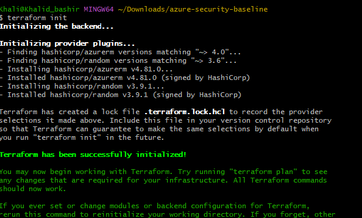

# Step-by-step: deploy the baseline from the terminal

These steps work in **Git Bash on Windows** and in **Kali Linux** (or any
Debian-based distro). Commands that differ are marked per platform.

> Everything here runs against your own Azure subscription. Use a free account,
> keep the default cost settings, and run `terraform destroy` when you are done.

## 0. Prerequisites

- An Azure account with an active subscription ([free account](https://azure.microsoft.com/free/))
- Git
- Terminal: Git Bash (Windows) or a shell on Kali Linux

## 1. Install Azure CLI

**Git Bash (Windows)**

```bash
winget install --exact --id Microsoft.AzureCLI
```

Close and reopen Git Bash afterwards so `az` is on the PATH.

**Kali Linux**

```bash
curl -sL https://aka.ms/InstallAzureCLIDeb | sudo bash
```

Verify:

```bash
az version
```

## 2. Install Terraform

**Git Bash (Windows)**

```bash
winget install --exact --id Hashicorp.Terraform
```

Reopen Git Bash, then verify with `terraform version`.

**Kali Linux** (download the binary directly, since HashiCorp's apt repo does not
recognise Kali's release name)

```bash
sudo apt update && sudo apt install -y unzip jq curl
TF_VERSION=$(curl -s https://checkpoint-api.hashicorp.com/v1/check/terraform | jq -r .current_version)
curl -fsSLO "https://releases.hashicorp.com/terraform/${TF_VERSION}/terraform_${TF_VERSION}_linux_amd64.zip"
unzip -o "terraform_${TF_VERSION}_linux_amd64.zip"
sudo mv terraform /usr/local/bin/
rm "terraform_${TF_VERSION}_linux_amd64.zip"
terraform version
```

On an ARM machine, replace `linux_amd64` with `linux_arm64`.

## 3. Log in to Azure

```bash
az login
```

A browser window opens. On a machine without a browser (for example a remote Kali VM), use:

```bash
az login --use-device-code
```

Check which subscription is active and copy its ID:

```bash
az account show --query "{name:name, id:id}" -o table
```

If you have more than one, select the right one:

```bash
az account set --subscription "<subscription-id>"
```

## 4. Register resource providers (first time on a new subscription)

New subscriptions sometimes lack the providers this baseline uses. Registering
them is safe and free. `versions.tf` sets `resource_provider_registrations = "none"`,
so Terraform does not try to register providers itself (its automatic registration
walks a long list and can take a long time), which means you must do it here
**before** `terraform plan`:

```bash
for ns in Microsoft.OperationalInsights Microsoft.Insights Microsoft.Security Microsoft.PolicyInsights Microsoft.Consumption; do
  az provider register --namespace "$ns"
done
```

Registration can take a few minutes. Wait until every provider reports
`Registered`:

```bash
for ns in Microsoft.OperationalInsights Microsoft.Insights Microsoft.Security Microsoft.PolicyInsights Microsoft.Consumption; do
  echo -n "$ns: "; az provider show --namespace "$ns" --query registrationState -o tsv
done
```

## 5. Get the code

```bash
git clone https://github.com/adankhalid0/azure-security-baseline.git
cd azure-security-baseline
```

## 6. Configure your variables

```bash
cp terraform.tfvars.example terraform.tfvars
```

Open `terraform.tfvars` in an editor (`nano terraform.tfvars`) and set:

```hcl
subscription_id = "<your subscription id from step 3>"
location        = "norwayeast"
alert_emails    = ["you@example.com"]   # budget alerts; leave [] to skip
monthly_budget  = 10
```

`terraform.tfvars` is git-ignored, so your subscription ID is never committed.

## 7. Initialise and review

```bash
terraform init
terraform fmt -recursive
terraform validate
terraform plan -out=tfplan
```



Commit the generated `.terraform.lock.hcl` so provider versions stay pinned.
Do **not** interrupt `terraform plan` or `apply` with Ctrl+C while it is
registering providers or creating resources, as that can leave things half
finished.

Read the plan. You should see a resource group, a Log Analytics workspace, a
diagnostic setting, a storage account, policy assignments and Defender pricing
entries (and a budget if you set an e-mail). Nothing is created yet.

## 8. Apply

```bash
terraform apply tfplan
```

When it finishes you should see `Apply complete! Resources: 12 added, 0 changed, 0 destroyed.`


Show the outputs again at any time:

```bash
terraform output
```

The resource group now holds the workspace and the storage account:


## 9. Verify in the portal and with KQL

1. In the Azure portal, open **Log Analytics workspaces** and select `secbase-law`.
2. Go to **Logs** and run:

   ```kusto
   AzureActivity
   | where TimeGenerated > ago(1d)
   | summarize count() by OperationNameValue, ActivityStatusValue
   | order by count_ desc
   ```

   Activity logs can take several minutes to appear after the first apply.

   

3. Open **Policy > Compliance** to see the audit results for the assigned policies.
   Expected: the storage policies are *Compliant*; *Network Watcher* may show
   *Not started* for a while. The Microsoft-managed *ASC Default* initiative also
   appears and reports non-compliance. It is not part of this baseline.

   

   Opening a policy shows its effect (`Audit`):

   

Or check from the terminal:

```bash
az monitor log-analytics workspace show \
  --resource-group secbase-rg --workspace-name secbase-law \
  --query "{name:name, retention:retentionInDays}" -o table

az policy assignment list --query "[].displayName" -o tsv
```

## 10. Clean up

```bash
terraform destroy
```

Confirm with `yes`. It ends with `Destroy complete! Resources: 12 destroyed.`


Then check that the resource group is gone:

```bash
az group list --query "[].name" -o tsv
```

## Troubleshooting

| Symptom | Likely cause and fix |
|---------|----------------------|
| `az: command not found` (Git Bash) | Reopen Git Bash after installing, or restart the computer |
| `terraform: command not found` | Same as above, or confirm `/usr/local/bin` is on your PATH (Kali) |
| `MissingSubscriptionRegistration` | Run the provider registration in step 4 and wait until each provider shows `Registered` |
| `plan` hangs registering unrelated providers (for example `Microsoft.AVS`) | Make sure `resource_provider_registrations = "none"` is set in `versions.tf` and register the providers manually (step 4) |
| `policy definition ... not found` | The built-in policy's display name changed. Search for it with `az policy definition list --query "[?contains(displayName,'Network Watcher')].{n:displayName,id:name}" -o table` and update `policy.tf` |
| Storage account name error | Names must be globally unique and lowercase. Re-run `terraform apply`, or change `prefix` |
| `AuthorizationFailed` | Your account needs Owner or Contributor + User Access Administrator on the subscription |
| `terraform fmt -check` fails in CI | Run `terraform fmt -recursive` locally and commit the result |

## Cost notes

On default settings the paid Defender plans are off, the Log Analytics workspace
has a 1 GB/day ingestion cap, and the optional budget e-mails you at 80% of the
monthly limit. Run `terraform destroy` after testing.
